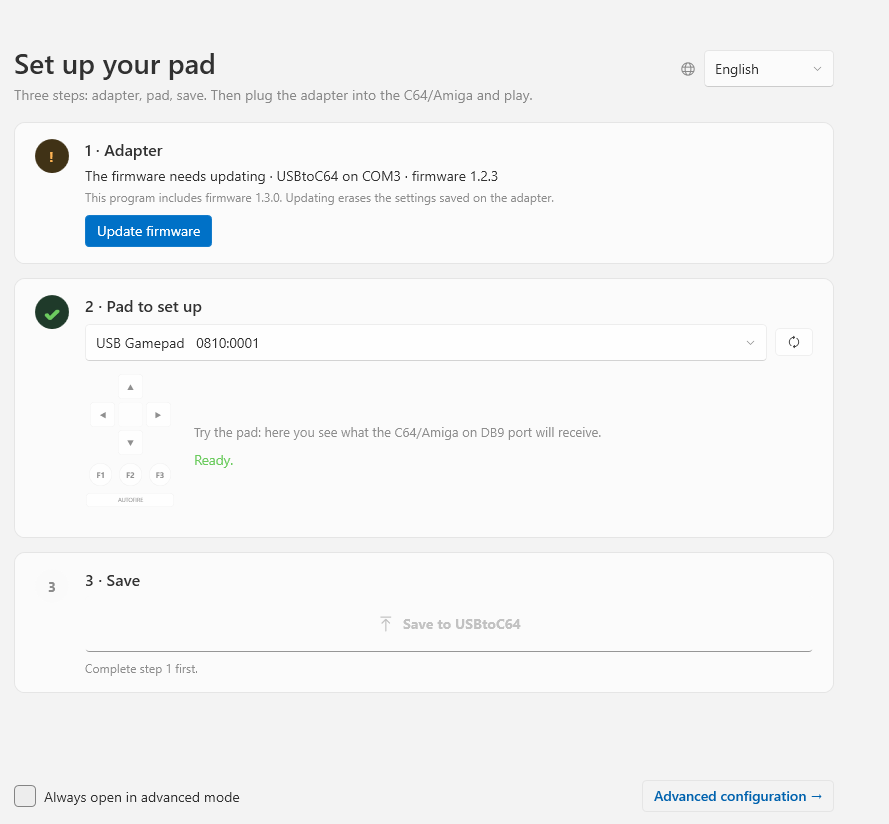
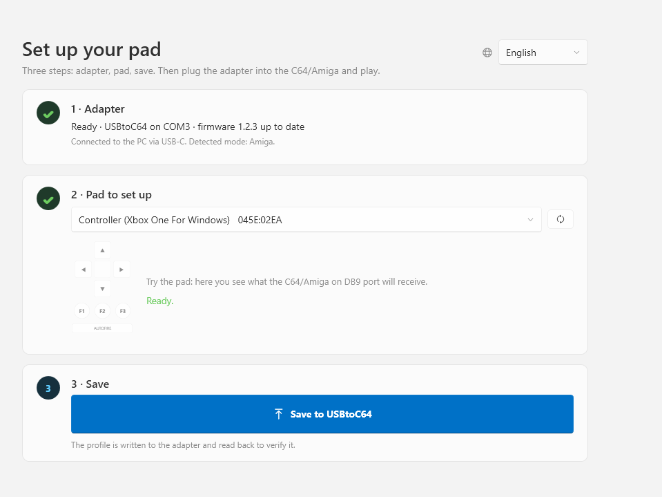
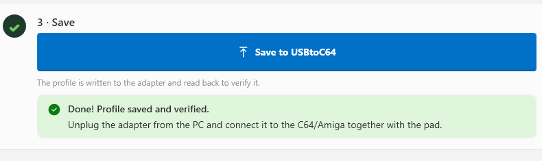
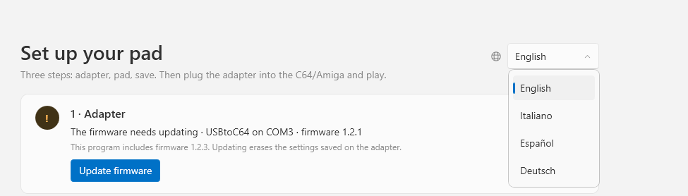

# 🪟 USBtoC64 Config for Windows

A Windows program that sets up the adapter for your controller in three clicks: it checks the adapter,
recognises the pad, and saves the right profile — no web configurator, no Arduino IDE, no manual mapping.

**[⬇️ Download USBtoC64_Adv_Win_x64.zip](https://github.com/jajpohke/USBtoC64_AMI_CFG_Adv/releases/latest/download/USBtoC64_Adv_Win_x64.zip)**

> ⚠️ **NEVER connect the adapter to the PC and to the C64/Amiga at the same time.** Set it up on the PC first,
> then unplug it and connect it to the computer. See the *Safety Warnings* in the [README](README.md).

---

## 📋 What you need

- A PC with **Windows 10 or 11, 64-bit**.
- The USBtoC64 adapter and a **USB-C data cable** (some cables only carry power).
- The **controller** you want to use, connected **to the PC** (USB cable or its own USB receiver).

The zip contains:

| File | What it is |
|---|---|
| `USBtoC64Config.exe` | the program |
| `USBtoC64_Adv.bin`, `firmware.json` | the adapter firmware included with the program (version 1.3.0) |
| `esptool.exe` | the tool used to install the firmware |
| `usbtoc64.exe` | the same functions from the command line (for advanced users) |

Nothing to install: unzip the folder anywhere and keep the files together.

---

## 🚀 First start

1. Unzip `USBtoC64_Adv_Win_x64.zip` into a folder.
2. Double-click **`USBtoC64Config.exe`**.
3. The program is not signed, so Windows SmartScreen may show *"Windows protected your PC"*:
   click **More info → Run anyway**. Your browser may also warn about the download: choose **Keep**.
4. Close other programs that use the adapter's port (Arduino IDE, the web configurator), otherwise the
   program can't talk to the adapter.

The program opens in the **simple mode**: one screen, three steps.

---

## 🎮 Simple mode

### 1 · Adapter

Connect the adapter to the PC with the USB-C cable (**without** the C64/Amiga). The program finds it by itself.

| What you see | What to do |
|---|---|
| ✔ **Ready** | nothing: go to step 2 |
| ⚠ **The firmware needs updating** | click **Update firmware** (see below) |
| ✖ **Adapter not found** | check the cable, close other programs using the port, click **Retry** |
| ● **Blank adapter or in download mode** | a new board, or one with another firmware: click **Install firmware** |

**Updating the firmware.** The program includes the firmware it needs (1.3.0) and installs it by itself.

> ⚠️ The update **erases all the settings saved on the adapter** (controller profile, mouse, LED colours) and
> restores the defaults, like *Erase all* in the web configurator. Don't unplug the adapter while it runs.

If a controller needs a newer firmware (for example Xbox controllers or analog sticks), the program says so
and asks for the update before saving:

### 2 · Pad to set up

Choose your controller from the list (connect it to the PC and press the refresh button if it isn't there).
The program reads it, recognises directions and buttons and prepares the profile automatically.

Press the buttons and move the sticks: the small preview shows **what the C64/Amiga on DB9 port will receive**
(directions, Fire 1/2/3, autofire). If something doesn't work as you like, see
*Advanced configuration* below.

### 3 · Save

When steps 1 and 2 show ✔, click **Save to USBtoC64**. The profile is written to the adapter and **read back to
verify it**.

When you see **Done! Profile saved and verified.**, unplug the adapter from the PC and connect it to the
C64/Amiga together with the controller.

---

## 🌍 Language

The program is in **English, Italiano, Español and Deutsch**. Choose the language from the list with the globe
at the top right (or in *Settings* in the advanced configuration). It changes at once and is remembered.

---

## 🕹️ Supported controllers

- **USB HID gamepads and joysticks** (most generic, PlayStation-style and retro pads).
- **Xbox 360** wired controllers and compatibles.
- **Xbox One / Series** controllers connected with a USB cable.

Analog sticks are supported with firmware 1.2.3 and later (1.3.0 is included).

---

## 🗄️ Profile slots (firmware 1.3.0)

The adapter keeps up to **8 pad profiles**, one per controller, and uses by itself the one of the controller you
plug in: you can switch pads without setting anything up again.

- **Simple mode:** *Save to USBtoC64* gives the profile a name automatically (from the controller name, e.g.
  "Xbox One For Windows") and puts it in the controller's own slot, or in a free one. At start-up step 1 lists the
  pads already configured, so you can see at once whether a pad needs to be saved.
- **Advanced configuration → Profile slots:** the 8 slots with name, VID:PID and number of rules. You can
  **rename** a slot, **delete** it, or **edit** it — even without the controller: the program remembers the
  controllers it has seen; Xbox controllers have a fixed layout; for a controller never connected to this PC only
  the buttons already in the slot are shown. When writing from the advanced configuration you choose the slot and
  the name.
- **Web configurator:** its saves go to the controller's slot (or a free one, or the oldest when all 8 are in use)
  and appear as **WebConfigured** until you rename them.
- Updating the firmware erases all the slots: the program lists the configured pads before going on.

## ⚙️ Advanced configuration

*Coming soon.* Click **Advanced configuration →** at the bottom of the simple screen for the full program:
controller mapping, mouse, LED colours, settings, firmware, serial terminal and log.

---

## ❓ Notes

- **Web configurator:** firmware 1.3.0 is fully compatible with the [web configurator](https://raw.githack.com/jajpohke/USBtoC64_AMI_CFG_Adv/main/configurator/index.html); you can keep using both.
- **Original firmware:** to go back to the firmware published on this page, use *Firmware → Install from file…*
  in the advanced configuration (any complete `.bin` image, also Emanuele's original one).
- **Unexpected error:** the program saves the details in `USBtoC64Config-errore.txt` next to the exe; attach it when
  you report the problem.
- More help: [Troubleshooting & FAQ](TROUBLESHOOTING.md).
