# 🪟 USBtoC64 Config for Windows

A Windows program that sets up the adapter for your controllers in three clicks: it checks the adapter,
recognises the pad and saves the right profile — no web configurator, no Arduino IDE, no manual mapping.
The adapter keeps up to **8 pad profiles** and uses by itself the one of the pad you plug in.

**[⬇ Download USBtoC64_Adv_Win_x64.zip](https://github.com/jajpohke/USBtoC64_AMI_CFG_Adv/releases/latest/download/USBtoC64_Adv_Win_x64.zip)**

> ⚠ **NEVER connect the adapter to the PC and to the C64/Amiga at the same time.** Set it up on the PC first,
> then unplug it and connect it to the computer. See the *Safety Warnings* in the [README](README.md).

**Contents:** [What you need](#-what-you-need) · [First start](#-first-start) · [Simple mode](#-simple-mode) ·
[Advanced configuration](#-advanced-configuration) · [Supported controllers](#-supported-controllers) ·
[Command line](#-command-line) · [Notes](#-notes)

---

## 📋 What you need

- A PC with **Windows 10 or 11, 64-bit**.
- The USBtoC64 adapter and a **USB-C data cable** (some cables only carry power).
- The **controller** you want to use, connected **to the PC** (USB cable or its own USB receiver).

The zip contains:

| File | What it is |
|---|---|
| `USBtoC64Config.exe` | the program |
| `USBtoC64_Adv.bin`, `firmware.json` | the adapter firmware included with the program (version 1.3.0) |
| `esptool.exe` | the tool used to install the firmware |
| `usbtoc64.exe` | the same functions from the command line (for advanced users) |

Nothing to install: unzip the folder anywhere and keep the files together.

---

## 🚀 First start

1. Unzip `USBtoC64_Adv_Win_x64.zip` into a folder.
2. Double-click **`USBtoC64Config.exe`**.
3. The program is not signed, so Windows SmartScreen may show *"Windows protected your PC"*:
   click **More info → Run anyway**. Your browser may also warn about the download: choose **Keep**.
4. Close other programs that use the adapter's port (Arduino IDE, the web configurator), otherwise the
   program can't talk to the adapter.

The program opens in the **simple mode**: one screen, three steps. It speaks **English, Italiano, Español and
Deutsch**: choose the language from the list with the globe at the top right — it changes at once and is remembered.


---

## 🎮 Simple mode

### 1 · Adapter

Connect the adapter to the PC with the USB-C cable (**without** the C64/Amiga). The program finds it by itself.

| What you see | What to do |
|---|---|
| ✔ **Ready** | nothing: go to step 2. Below it you see the pads already configured on the adapter. |
| ⚠ **The firmware needs updating** | click **Update firmware** (see below) |
| ✖ **Adapter not found** | check the cable, close other programs using the port, click **Retry** |
| ● **Blank adapter or in download mode** | a new board, or one with another firmware: click **Install firmware** |

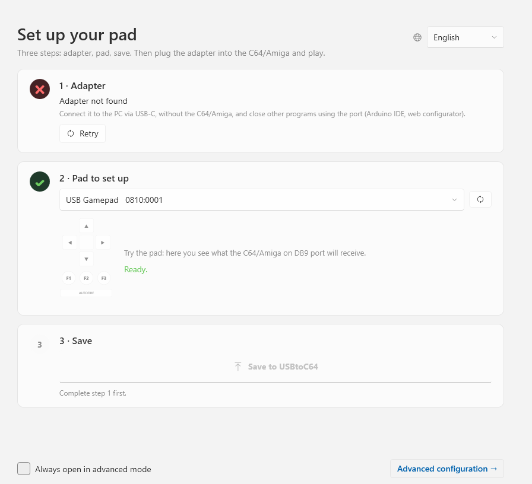

#### Updating the firmware

The program includes the firmware it needs (1.3.0) and installs it by itself. If a controller needs a newer
firmware (for example Xbox controllers or analog sticks), step 2 says so and *Save* stays disabled until you update.


> ⚠ The update **erases all the settings saved on the adapter** (pad profiles, mouse, LED colours) and restores
> the defaults, like *Erase all* in the web configurator. Before starting, the program lists the pads that will be
> erased, so you know what to save again.

While it runs, a bar shows the phase and the progress: connection, **erasing the memory** (the bar moves without a
number for 10–20 seconds), **writing** with the percentage, check, restart. The orange strip reminds you not to
unplug the adapter; the program icon in the Windows taskbar fills up too, and closing the window asks for
confirmation.

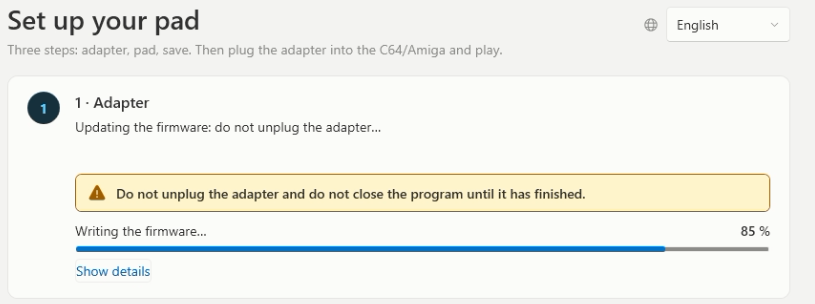

The number next to the bar is the progress of the **whole** operation: when the writing reaches 100 % it shows about
85 %, the rest is the check and the restart.

**Show details** opens a read-only box with everything the program and the adapter are saying (the esptool output,
the commands, the answers). **Copy** puts it on the clipboard: attach it when you report a problem.

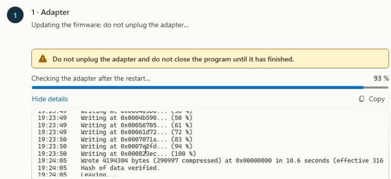

### 2 · Pad to set up

Choose your controller from the list (connect it to the PC and press the refresh button if it isn't there).
The program reads it, recognises directions and buttons and prepares the profile automatically.

Press the buttons and move the sticks: the small preview shows **what the C64/Amiga on DB9 port will receive**
(directions, Fire 1/2/3, autofire). The line below tells you where the profile will go:

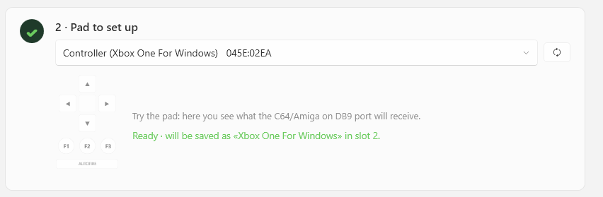

- *will be saved as «name» in slot N* — a new pad. The name comes from the controller
  ("Controller (Xbox One For Windows)" becomes "Xbox One For Windows"); you can rename it later.
- *already saved in slot N «name»* — this pad is already on the adapter, with this exact profile: nothing to do.
- *will update slot N «name»* — the pad is there but with a different profile.

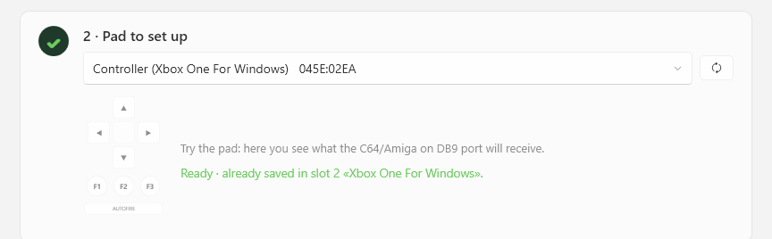

If something doesn't work as you like, see [Advanced configuration](#-advanced-configuration).

### 3 · Save

When steps 1 and 2 show ✔, click **Save to USBtoC64**. The profile is written to the adapter, the adapter restarts
and the profile is **read back to verify it**. The bar shows the phases (sending, restart, reading back, comparing).

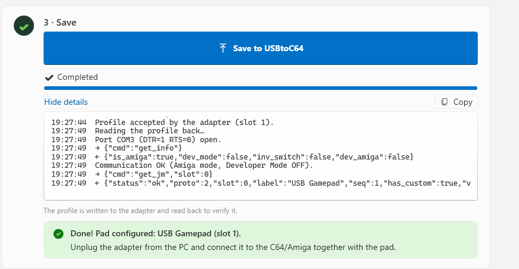

When you see **Done! Pad configured: name (slot N)**, unplug the adapter from the PC and connect it to the C64/Amiga
together with the controller.

**More pads:** plug in the next controller, press refresh, save again. Each pad gets its own slot; the adapter
recognises them by themselves, so you can swap pads on the C64/Amiga without setting anything up again.

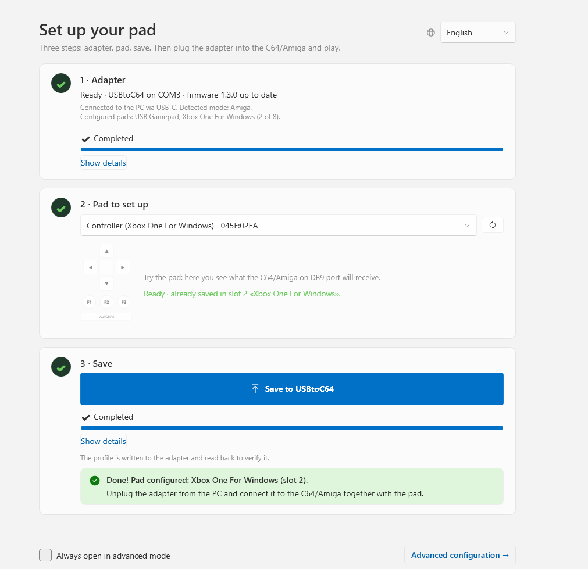

If all 8 slots are in use, the simple mode asks before replacing the one saved longest ago (choose another one
from the advanced configuration).

---

## ⚙ Advanced configuration

Click **Advanced configuration →** at the bottom of the simple screen (the checkbox next to it opens the program
always in this mode). **← Simple mode**, at the bottom left, brings you back. The card above it shows the port,
the firmware, the mode (C64 or Amiga) and how many pads are configured; **Check** reads the adapter again.

### Gamepad

The full mapping of the selected controller.

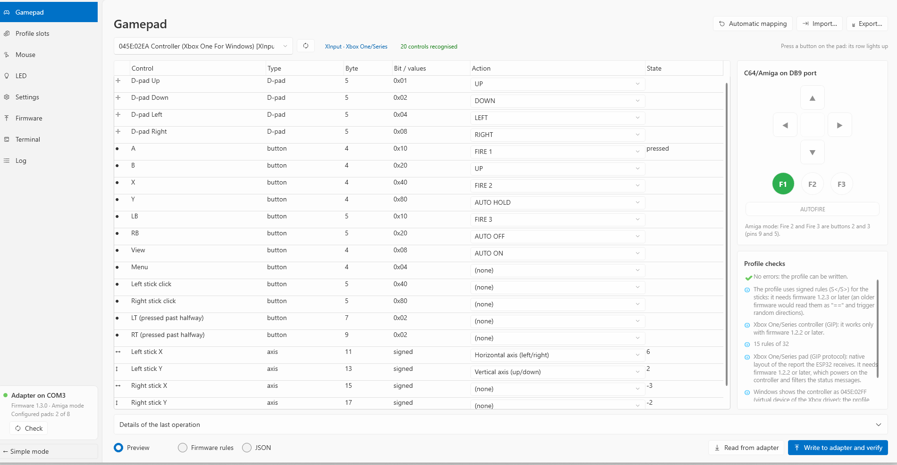

- The **table** lists every control the program found: type, byte and bits in the report the adapter receives,
  and the **action** sent to the C64/Amiga (directions, Fire 1/2/3, autofire on/off/hold, horizontal/vertical axis,
  or none). Press a button on the pad: its *State* column shows it and the preview on the right lights up.
- **C64/Amiga on DB9 port:** live preview with the adapter's own rules.
- **Profile checks:** errors (the profile cannot be written) and notes (firmware needed, rules used of 32…).
- **Automatic mapping** goes back to the proposal; **Import…/Export…** read and write profile files (`.json`, and the
  `JoystickMapping.h` files of the web configurators).
- **Preview / Firmware rules / JSON** switch the view: the rules show exactly what is stored on the adapter.
- **Read from adapter** compares the profile on the adapter with the one on screen.
- **Write to adapter and verify** asks for the **slot** and the **name**, then writes and reads back:

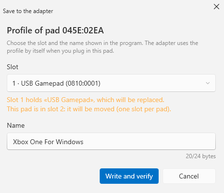

The proposed slot is the pad's own, else the first free one. If you choose a slot that holds another pad, the
dialog says it will be replaced; a pad lives in one slot only, so saving it in another slot moves it.

### Profile slots

The 8 slots of the adapter, with name, VID:PID, number of rules and notes (*analog stick*, *saved from the web
configurator*, *pad connected*).

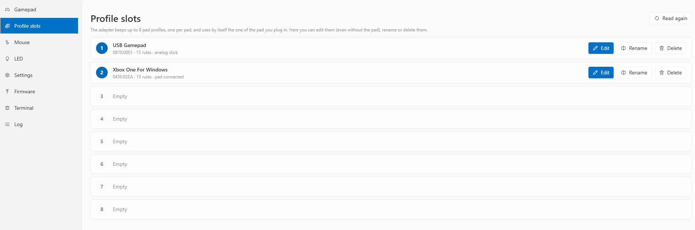

- **Rename** — the name is shown in the program and in the adapter's service menu (up to 24 bytes).
- **Delete** — the adapter will no longer recognise that pad until you save it again.
- **Edit** — opens the slot in the *Gamepad* page, **even without the controller**:

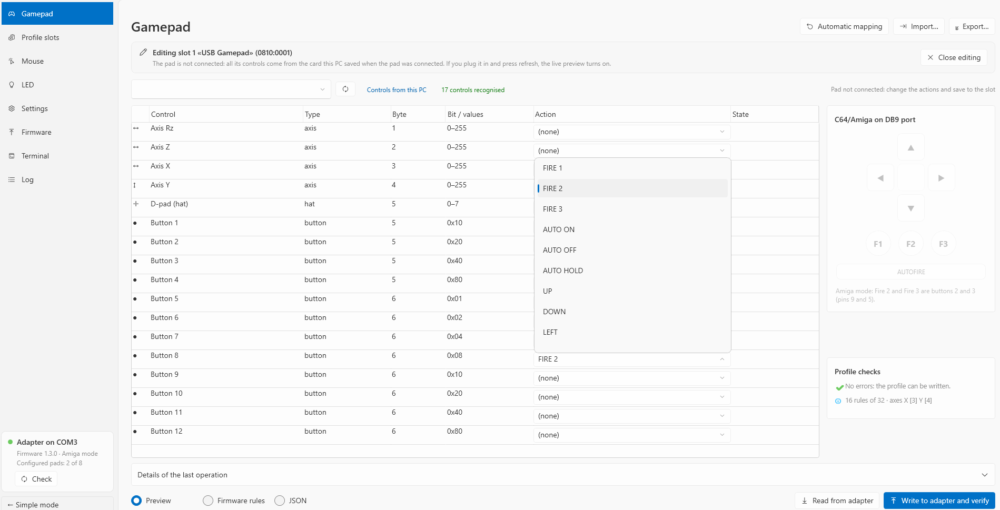

  - if the pad was connected to this PC before, the program remembers all its controls with their names
    (*Controls from this PC*);
  - Xbox controllers have a fixed layout, so all the buttons are always there;
  - for a pad never connected to this PC, only the controls already used in the slot are shown, with technical
    names (*Byte 5 · bit 0x20*); to add a control, connect the pad.

  Change the actions and press *Write to adapter and verify*: it saves to the same slot. If you plug in the pad while
  editing and press refresh, the live preview turns on and your changes are kept. **Close editing** goes back to the
  connected pad.

Profiles saved by the **web configurator** appear as **WebConfigured** until you rename them.

### Mouse, LED, Settings

- **Mouse:** pointer speed for Amiga and C64, wheel, PAL/NTSC timing.
- **LED:** the colour of each event (from the firmware palette), GRB/RGB chip format, single colour mode.

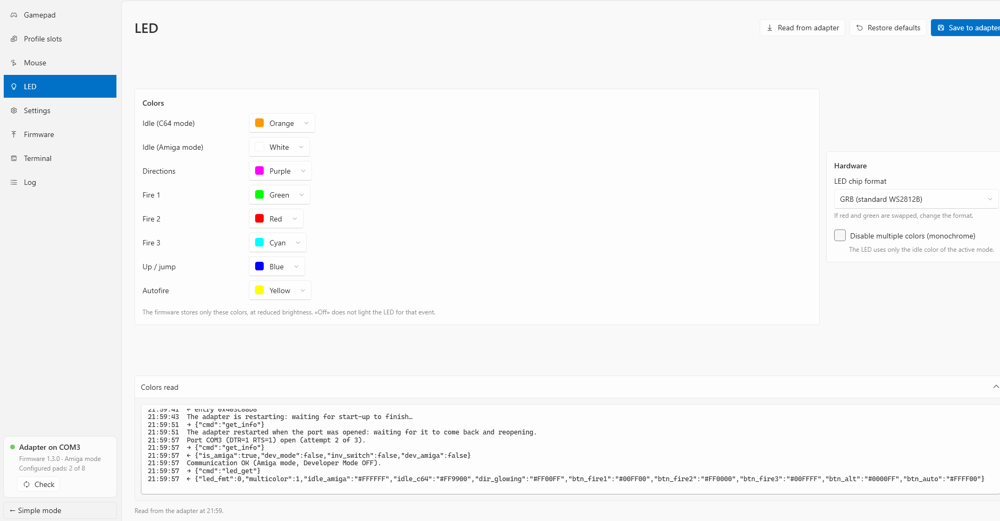

- **Settings:** program language, C64/Amiga switch inversion, Developer Mode, what is saved in the adapter memory
  (and clearing it), factory reset.

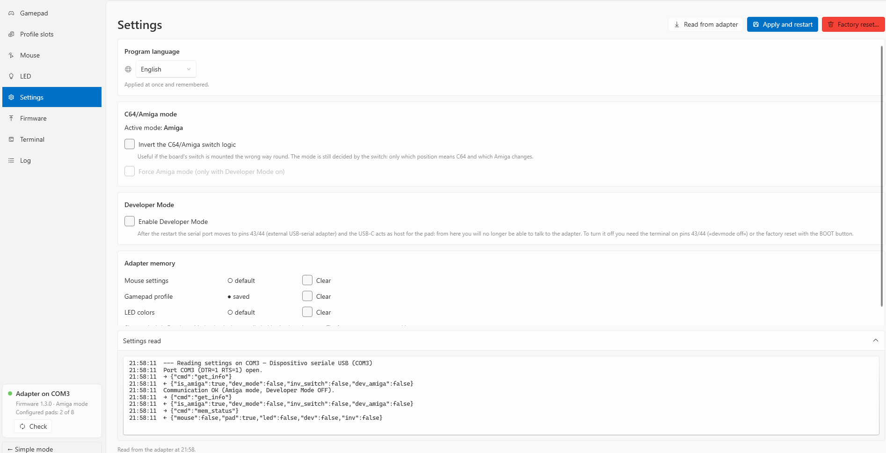

### Firmware

The version on the adapter and the one included in the program. **Update firmware…** installs the included one;
**Install from file…** writes any complete image at address 0x0 — for example Emanuele's original firmware.
Every installation erases all the settings (the program lists the configured pads first).

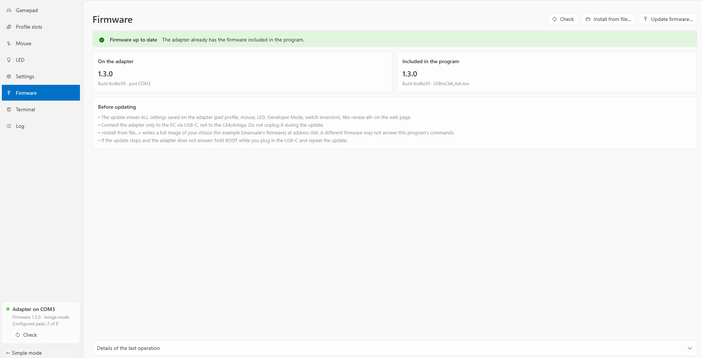

If an adapter does not answer at all (a blank board, or BOOT held while plugging it in), the program recognises the
ESP32 chip without writing anything and offers to install the firmware.

### Terminal and Log

- **Terminal:** the adapter's serial console. Quick commands (`service`, `info`, `dumppad`, `ledtest`, `exit`,
  `reboot`) and a command box for any command, also JSON ones. Commands that change something ask for confirmation;
  the connection comes back by itself after a restart.

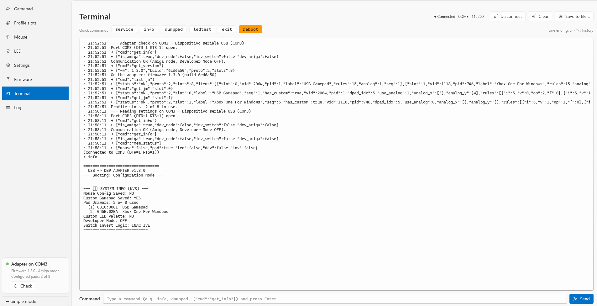

- **Log:** everything exchanged with the adapter during the session, can be saved to a file.

---

## 🕹 Supported controllers

- **USB HID gamepads and joysticks** (most generic, PlayStation-style and retro pads).
- **Xbox 360** wired controllers and compatibles (firmware 1.2.2 or later).
- **Xbox One / Series** controllers connected with a USB cable (firmware 1.2.2 or later).
- **Analog sticks** (Xbox and others with signed axes): firmware 1.2.3 or later.

The included firmware 1.3.0 supports all of them. Wireless Xbox controllers and the Xbox Wireless Adapter are not
supported: use a cable.

---

## ⌨ Command line

`usbtoc64.exe` does the same from a terminal (in English; `--lang it|es|de` changes the language):

```
usbtoc64 devices
usbtoc64 analyze 0 -o profile.json
usbtoc64 monitor 0
usbtoc64 write profile.json --slot 3 --label "PS3 black"
usbtoc64 slots
usbtoc64 slot-rename 3 "PS3 red"
usbtoc64 slot-delete 3
usbtoc64 version
usbtoc64 flash
```

`usbtoc64 help` lists all the commands.

---

## ❓ Notes

- **Web configurator:** firmware 1.3.0 is fully compatible with the
  [web configurator](https://raw.githack.com/jajpohke/USBtoC64_AMI_CFG_Adv/main/configurator/index.html); you can keep
  using both. Its saves go to the pad's slot (or a free one, or the oldest when all 8 are in use).
- **Original firmware:** to go back to another firmware use *Firmware → Install from file…* (any complete `.bin`
  image, also Emanuele's original one).
- **Unexpected error:** the program saves the details in `USBtoC64Config-errore.txt` next to the exe; attach it when
  you report the problem, together with the text copied from *Show details*.
- More help: [Troubleshooting & FAQ](TROUBLESHOOTING.md).
